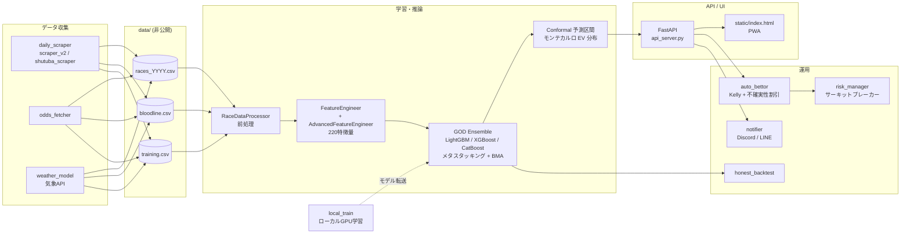

# keiba-predictor — 競馬AI予測システム

> 本プロジェクトは **Claude Code を用いたAI駆動開発** で設計・実装しました。

JRA のレースデータから勝率・期待値（EV）を予測する機械学習システムです。
LightGBM / XGBoost / CatBoost などを組み合わせたアンサンブルモデルを FastAPI で提供し、PWA 対応の単一ページ UI から予測・バックテスト・ペーパートレードを確認できます。

※ **ペーパートレード専用**です（実際の馬券購入は行いません）。
※ 学習済みモデル（`models/*.pkl`）と、外部サイトから取得したレースデータ（`data/`）はリポジトリに含めていません。

## 構成図



## 技術スタック

| 分類 | 使用技術 |
|---|---|
| 言語 | Python 3.12 |
| 機械学習 | LightGBM, XGBoost, CatBoost, scikit-learn, TabNet（PyTorch）, Optuna, SHAP, statsmodels |
| データ処理 | pandas, NumPy, SciPy |
| API | FastAPI, Uvicorn, JWT（python-jose）, passlib / bcrypt |
| フロントエンド | 単一 HTML + Vanilla JS（PWA: Service Worker / manifest） |
| データ収集 | requests, BeautifulSoup4, lxml |
| 通知 | Discord Webhook, LINE Notify |
| インフラ | Docker, systemd, ローカル GPU 学習 → VPS へのモデル転送 |

## 主な機能

- **レース予測 API**：`GET /api/predict/{race_id}` で各馬の勝率・EV・予測着順の信頼区間を返す
- **不確実性の可視化**：モンテカルロによる EV 分布（平均・標準偏差・四分位）と、Conformal Prediction による着順の 80% / 95% 区間
- **ペーパートレード**：Kelly 基準に不確実性割引をかけた賭け金サイズで自動ベットをシミュレーション
- **バックテスト**：Sharpe レシオ、ブートストラップ信頼区間、プロフィットファクター、最大連敗などを算出
- **管理画面**：リスク停止 / 再開、モデル・スクレイパー・キャッシュの状態確認（admin のみ）
- **通知**：期待値の高いレースを Discord / LINE に配信

## 工夫した点

- **データリーク対策**：予測時に対象レースの着順・タイム・賞金・通過順・上がり3Fをマスクしてから特徴量を作り、学習時と推論時で同じパイプラインを通す。リーク検知はテスト（`tests/test_leak_guard.py`）で担保
- **過去履歴の結合バグの修正**：GET 版の予測で各馬の過去データを結合しておらず、25 以上の特徴量が 0 で埋まっていた問題を発見し、POST 版と同一パイプラインに統一
- **リスク管理のサーキットブレーカー**：ドローダウン、日次・週次の損失上限、連敗数、1レースあたりの上限で自動停止し、クールダウン後に再開
- **「正直な」バックテスト**：時系列を守った検証とブートストラップ CI で、偶然の好成績を過大評価しない
- **スタッキングのフォールバック判定**：正例率が約 6%（1/16）と低いため、絶対値の閾値ではなく予測値の標準偏差（std < 1e-3）で縮退を検出
- **認証まわり**：JWT 署名鍵は環境変数、なければ初回起動時に自動生成して 0600 で保存。ログインはユーザー単位・IP 単位の二重レート制限

## セットアップ

```bash
git clone https://github.com/ten-ten66/keiba-predictor.git
cd keiba-predictor
python3 -m venv venv && source venv/bin/activate
pip install -r requirements.txt

cp .env.example .env   # KEIBA_JWT_SECRET / KEIBA_ADMIN_PASSWORD などを設定
export $(grep -v "^#" .env | xargs)

# レースデータを data/ に、学習済みモデルを models/keiba_model.pkl に配置してから起動
uvicorn api_server:app --host 127.0.0.1 --port 8000
# → http://127.0.0.1:8000/api/health

# テスト（test_api.py は起動中のサーバーが必要）
pytest tests/ -v
```

学習はローカル GPU 環境で行う想定です（[`local_training/README.txt`](local_training/README.txt)）。
